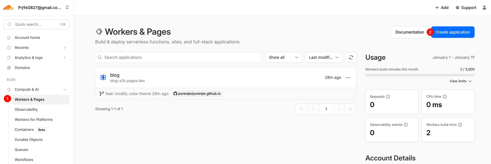
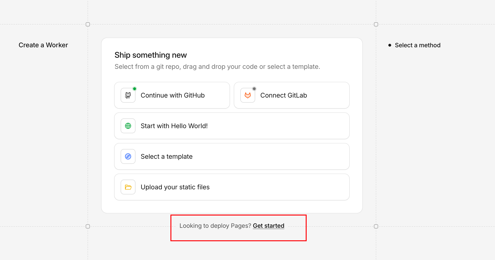
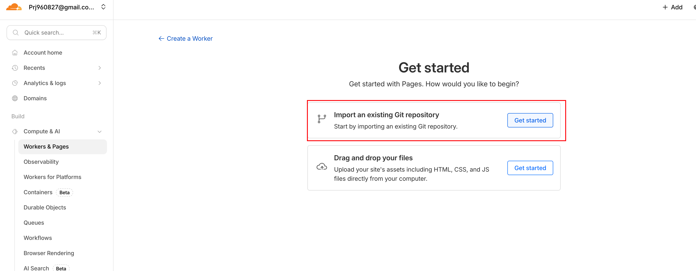
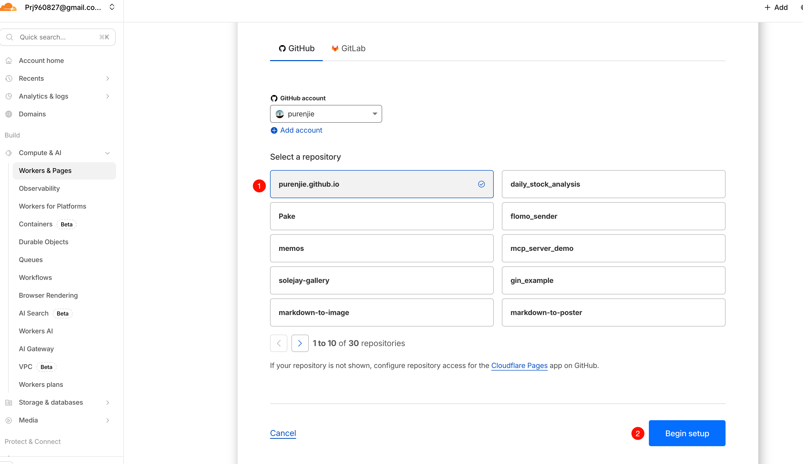
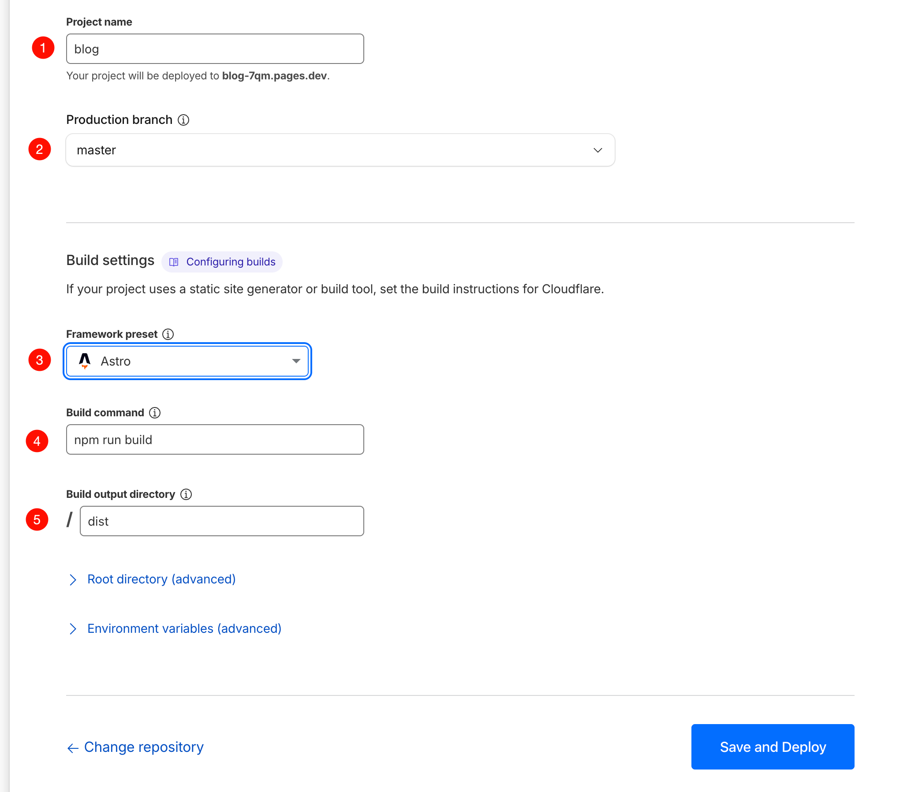
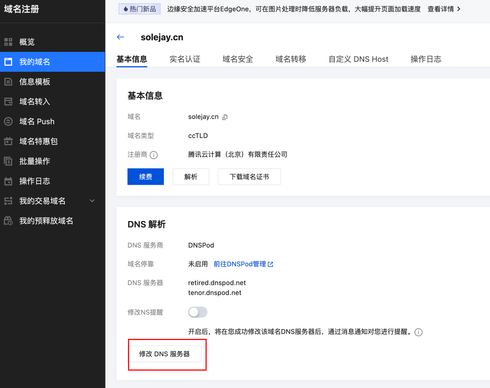
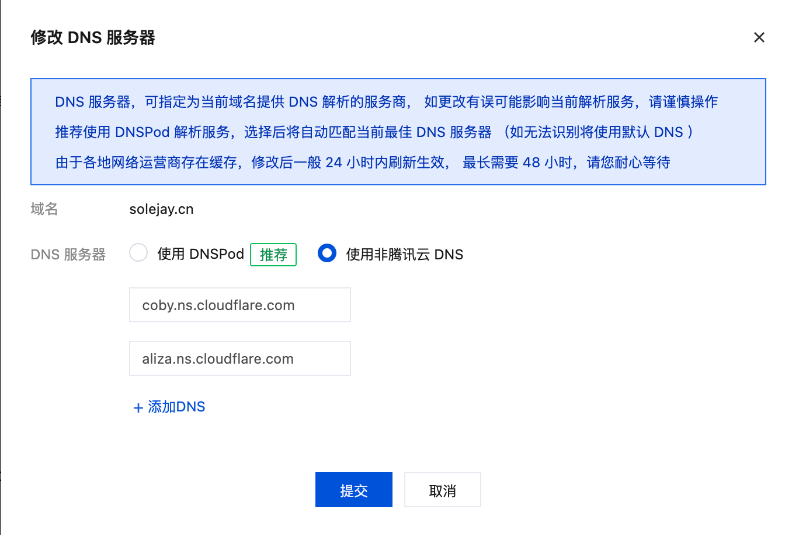
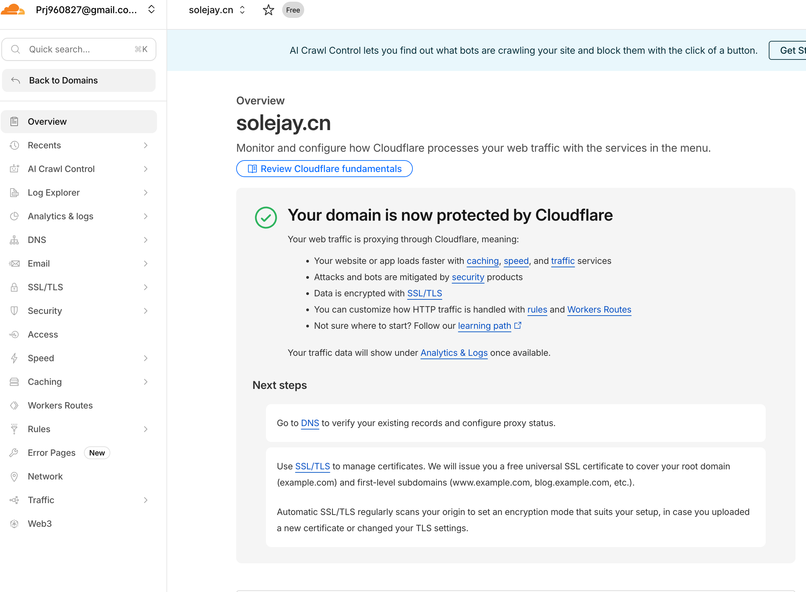

## 缘由

最近给博客换了一个字体——[仓耳今楷04-W04](https://tsanger.cn/product/43)，但是会遇到字体加载很慢的情况，想了一些办法，比如把 `ttf` 文件转换成 `woff` 格式，字体大小从 19.1MB 缩小到 8.8MB，但是还是不够快。后来看到可以提取其中一部分的字体，这样可以让字体的大小变得更小，就让 AI 给我压缩了一下，但是发现有的字没有被压缩进去，导致渲染有问题。

之前看到有很多 cdn 加速的方式，就在网上查询，不出意外赛博大善人 `cloudflare` 又免费提供 cdn 加速。顺着这个，又看到他们提供了免费的 `pages` 的服务，连服务器都不用我出了。相比自己的服务器，`cloudflare` 速度更快，服务更稳，就算后面我的服务器过期了也没事，所以打算把博客迁移到 `cloudflare`。

## 迁移过程

### CloudFlare 部署

由于我已经配置好了 `github` 的部署方式，代码推送到 `github` 之后会自动部署到 [github pages](https://purenjie.github.io/)，`cloudflare` 已经支持自动导入 `github` 的仓库进行部署，所以整体的流程十分丝滑。

这里需要选择下面标红的，默认创建的是 `Worker`

关联自己的账户，选择仓库并开始

自定义项目的名称，然后我选择 `Astro` 之后，下面的命令就自动关联了，然后部署即可

部署之后，会分配到一个域名 [blog-a3h.pages.dev](https://blog-a3h.pages.dev/)，这个域名可以直接访问博客

### 域名迁移

登录腾讯云的[域名管理](https://console.cloud.tencent.com/domain/all-domain/manage)，修改为 cloudflare 给的 DNS 服务器地址，然后回到 cloudflare，看到域名已经迁移过来了

